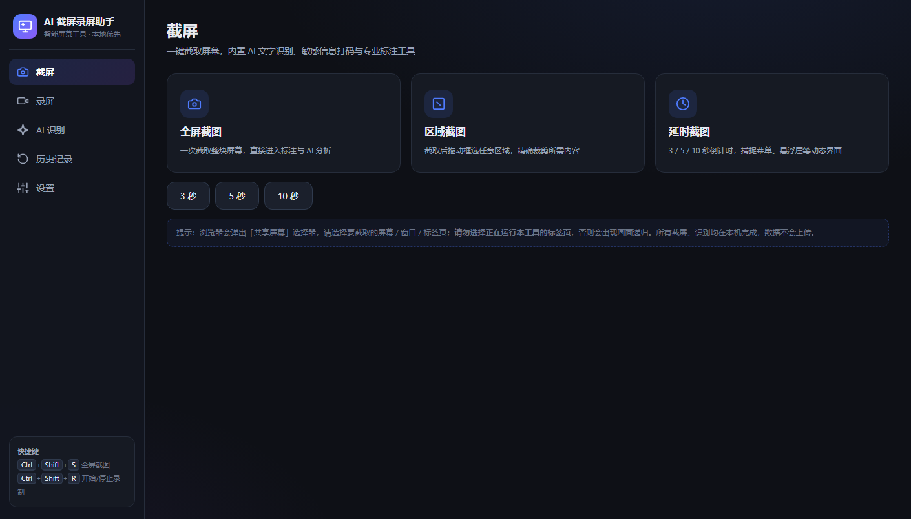

# AI 截屏录屏助手

一个**纯本地运行**的截图 / 录屏 / OCR / 翻译工具。零依赖、零安装、双击即用。

所有识别与处理都在本机浏览器内完成，**图片不上传**；只有需要翻译时，才会把「识别出的文字」发送给翻译服务。



---

## 功能

### 截屏
- **全屏遮罩框选**：按下热键，屏幕变暗，拖鼠标框选区域，松开即完成
- 支持整屏截图、延迟截图
- 截图自动保存到 `captures/`，同时复制到剪贴板
- 内置编辑器：画笔、箭头、矩形、文字标注、马赛克、打码框、裁剪
- 滤镜：对比度增强、转黑白

### 全局热键（录屏软件常用做法）
- 常驻托盘小程序，**任何界面**按 `Ctrl+Alt+S` 都能截图
- 快捷键可在设置里改，支持 `Ctrl` / `Alt` / `Shift` / `Win` 任意组合
- 热键被占用时自动切换到备选组合并提示

### OCR 文字识别
- 基于 Tesseract.js，**完全离线**，语言包随程序附带
- 识别结果会做清洗：去掉界面装饰噪声（`7|`）、修正混淆字符（`Sett1ngs` → `Settings`）
- 自动过滤图片/图标区域的「幻觉文字」——Tesseract 会把头像色块读成 `本`、`了属`，这类内容会被剔除

### 截图翻译
- **24 种语言**：中（简/繁）、英、日、韩、法、德、西、俄、葡、意、阿、印地、泰、越、印尼、马来、土、波、荷、瑞典、乌克兰、希伯来、希腊
- **双引擎**：内置 Google 免费接口（免配置）+ 可选大模型翻译（复用 OpenAI 兼容 API）
- **原文原位替换**：重建背景后把译文画回原位置，接近原生界面
- 三种呈现方式：原位替换 / 半透明底条 / 仅对照文本
- 背景重建会判断纯色还是渐变，渐变用逐条采样贴合；纹理太复杂时自动降级为底条
- 译文按原文估算字号，不会撑破按钮

### 敏感信息扫描
- 自动识别手机号、身份证号、银行卡号、邮箱、网址、API 密钥
- 一键打码后导出

### 录屏与 AI 总结
- 录制屏幕 / 应用窗口 / 浏览器标签页，支持系统声音与麦克风
- 录制时自动抓取关键帧做 OCR，生成内容时间线
- 配置 LLM 后可输出结构化总结

---

## 快速开始

### 方式一：双击启动（推荐）

```
双击 启动助手.bat
```

它会启动本地服务并自动打开浏览器。

### 方式二：手动启动

```bash
node serve.js          # 默认 8787 端口
# 然后访问 http://127.0.0.1:8787/ai-capture-assistant.html
```

> **注意：必须通过 `http://` 访问，不能直接双击 HTML 文件。**
> 浏览器在 `file://` 下会禁用屏幕捕获接口，截图和录屏都无法使用。

### 启用全局热键（可选）

```
双击 启动全局热键.bat
```

托盘出现图标后，任何界面按 `Ctrl+Alt+S` 即可截图。

---

## 为什么截图必须走本地服务

浏览器安全策略规定：`getDisplayMedia`（屏幕捕获）**只能在安全上下文中调用**，即 `https://` 或 `http://localhost`。直接用 `file://` 打开 HTML 会被禁用。

所以本项目自带一个零依赖的 Node.js 静态服务器（`serve.js`），只用内置模块，不需要 `npm install`。

---

## 全局热键是如何实现的

浏览器不能注册系统级快捷键，也不能在后台截屏。所以采用「托盘守护进程 + 浏览器」的组合：

```
按下热键
   ↓
PowerShell 守护进程收到系统热键（Win32 RegisterHotKey）
   ↓
调用 GDI 直接截屏（不经过浏览器）
   ↓
显示全屏遮罩，拖拽框选
   ↓
保存 PNG + 投递给已打开的网页（可选，自动翻译）
```

截图动作完全在原生层完成，**不需要跳转到网页**。

---

## 目录结构

```
.
├── ai-capture-assistant.html   主程序（单文件，含全部界面与逻辑）
├── serve.js                    零依赖本地服务
├── hotkey.ps1                  全局热键守护进程
├── hotkey.ini                  热键配置
├── 启动助手.bat                启动网页服务
├── 启动全局热键.bat            启动热键守护
├── core/                       Tesseract 引擎（离线）
├── tessdata/                   OCR 语言包（中文 + 英文）
└── captures/                   截图输出目录（运行时生成）
```

---

## 技术实现要点

### 打包体积与性能

| 项目 | 做法 |
|---|---|
| OCR 引擎 | Tesseract.js，wasm 随程序附带，不联网 |
| 语言包 | 本地 `tessdata/`，缺失时按需从 CDN 下载并落盘缓存 |
| 翻译批处理 | 多条文本换行拼接成一次请求，把往返次数压到 1~2 次 |
| worker 池 | 最多缓存 2 个 OCR worker，超出淘汰最旧的（多 worker 并存会拖死识别） |

### 踩过的坑（写在这里避免重复踩）

- **`chi_sim+eng` 组合语言包**：本地 `tessdata` 里只有分开的 `chi_sim.traineddata.gz` 和 `eng.traineddata.gz`，而 Tesseract 会去找 `chi_sim+eng.traineddata.gz` 这个组合文件，必然 404。语言串必须按 `+` 拆成数组。
- **CDN 多语言**：`@tesseract.js-data/<lang>/` 每种语言是独立目录，一个 `langPath` 只能服务一种语言，不能叠加。
- **`conf=0` 的中文**：Tesseract 识别中文时常给出 `conf=0` 但文本正确的词（如「翔」），按置信度一刀切会把名字拆散。
- **词序**：不能按 bbox 的 x 坐标重排中文词，相邻字的框有轻微重叠会导致「这个亭子」变成「这亭子个」，必须用 OCR 原始顺序。
- **图片区域幻觉**：Tesseract 对头像、图标会「凭空造字」，需要用「背景色是否占主导」判断并过滤。
- **`Application.DoEvents()`**：在 WinForms 里会抽空线程消息队列，连 `WM_HOTKEY` 一起吞掉，导致热键失灵。

---

## 隐私说明

| 数据 | 是否离开本机 |
|---|---|
| 截图图片 | ❌ 永远留在本地 |
| OCR 识别 | ❌ 本地 wasm 计算 |
| 翻译 | ⚠️ 仅发送**识别出的文字** |
| LLM 总结 | ⚠️ 仅发送**OCR 文本** |
| API Key | ❌ 存在浏览器 localStorage |

如果对隐私要求极高，可以在设置里只使用 OCR 而不开翻译。

---

## 已知限制

- **中文 OCR 存在字词级误差**：Tesseract 中文模型对形近字（「茶叶」→「条叶」）和某些字序仍会出错，这是引擎本身的限制，后处理无法完全修复
- 全局热键仅支持 Windows（依赖 Win32 API）
- 多显示器目前只截主屏
- 部分 DRM 保护内容无法截屏

---

## 第三方组件与许可

| 组件 | 许可 |
|---|---|
| [Tesseract.js](https://github.com/naptha/tesseract.js) | Apache-2.0 |
| [tessdata](https://github.com/tesseract-ocr/tessdata) 语言包 | Apache-2.0 |
| 翻译接口 | Google Translate 公开端点（非官方 API，仅供个人学习使用） |

本项目代码以 MIT 许可开源，详见 [LICENSE](LICENSE)。

> 使用 Google 翻译端点时请遵守其服务条款。如需商用，建议自行配置大模型 API。

---

## 参与贡献

欢迎提 Issue 和 PR。特别欢迎：

- 更多语种的 OCR 语言包与翻译质量改进
- OCR 准确率优化（比如接入 PaddleOCR 的评估）
- 非 Windows 平台的全局热键方案
